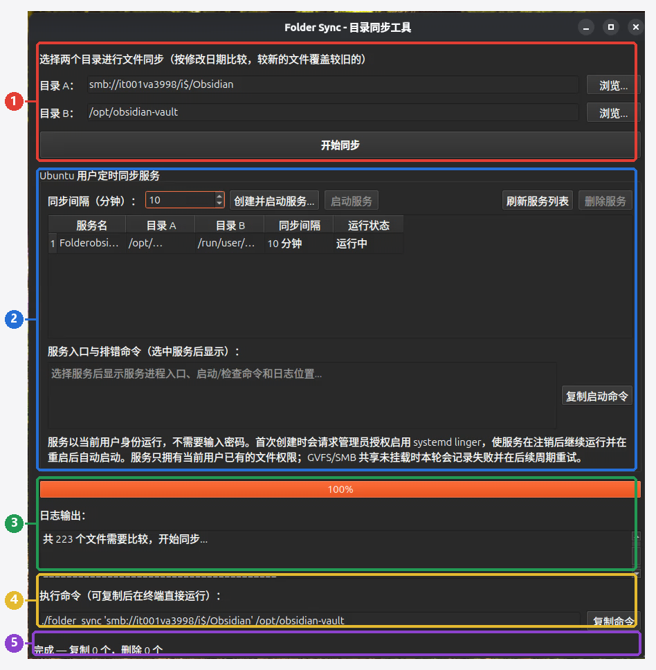
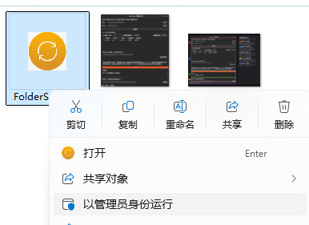
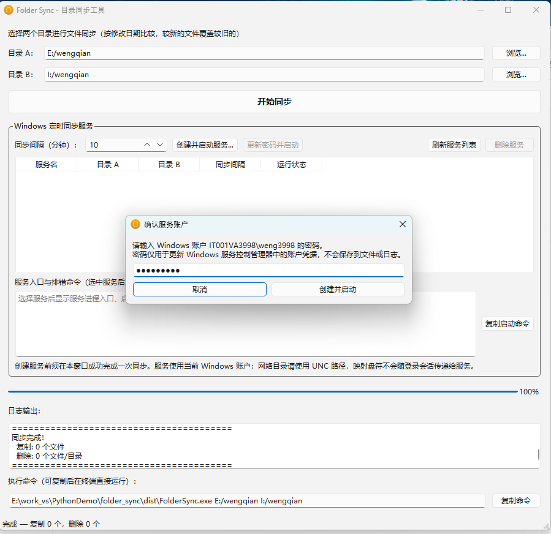
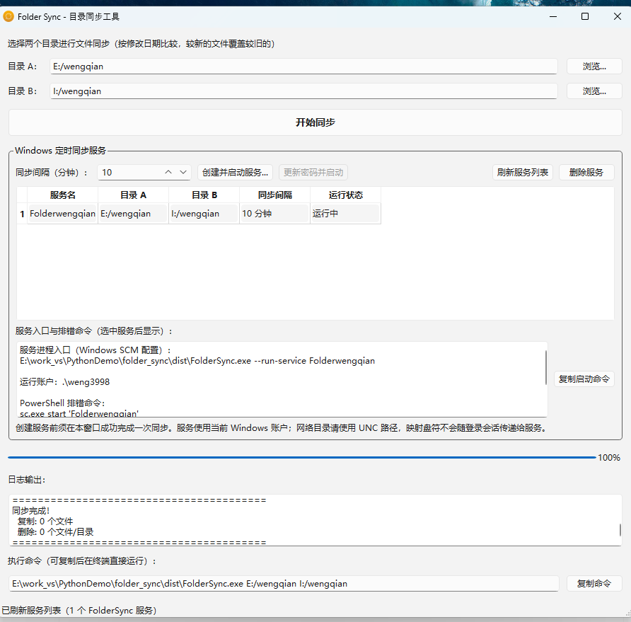
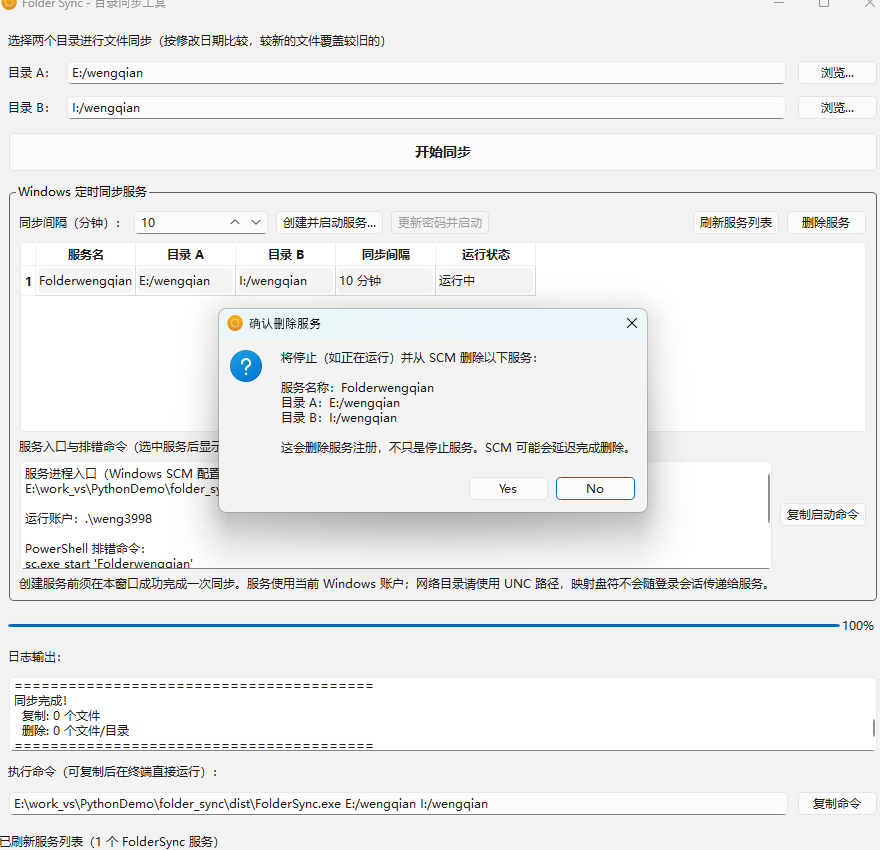

# FolderSync — 跨平台文件夹同步工具

   

基于 Python + PyQt6 的轻量级目录同步工具，支持 **Windows ↔ Windows（共享）** 与 **Ubuntu → Windows 共享（SMB）** 两种典型场景。
既是实用小工具，也是我学习 GitHub 协作与发布流程的入门项目。

---

## 这个 App 是什么

FolderSync 把"两台机器之间来回拷文件夹"这件琐事固化成一次配置、长期自动执行：

- **双模式运行**
  - 命令行模式：`FolderSync <目录A> <目录B>`，直接同步、不弹窗，适合脚本与定时任务；
  - 图形界面模式：不带参数启动即弹出 PyQt6 窗口，可视化选目录、看进度、拿命令。
- **智能同步逻辑**：按修改时间（mtime）双向比较，较新的文件覆盖较旧的；只同步内容，不自动删对端多余文件。
- **时间差防回拷**：内置可配置的时间容差窗口，刚同步过去的文件不会因时间戳微小偏差被反向拷回，杜绝 A→B→A 死循环。
- **`DEL_` 前缀定向删除**：在一端放一个 `DEL_xxx` 占位文件，同步后自动删除对端同名项并清理占位，实现"我删了，你也删"（前缀可配置）。
- **忽略系统噪音**：自动跳过 `Thumbs.db`、`Desktop.ini`、`*.tmp`、`*.lnk`、页面文件，以及 `$Recycle.Bin`、`System Volume Information` 目录。
- **网络路径友好**：支持 Windows 共享路径（`//tsclient/…`）与 SMB 路径（`smb://…`）。
- **定时服务**：Windows（SCM）与 Ubuntu（systemd user）各有一套独立实现，UI 与同步核心共用；注销后仍可继续运行。
- **命令回显**：GUI 底部生成对应的终端命令，一键复制，可直接代替服务使用。

技术栈：Python 3.10+ · PyQt6 6.12.0 · PyInstaller 6.22.3（`pywin32` 仅 Windows 需要）。

---

## 界面地图：五个区域，五种颜色

下图是 GUI 主界面（Ubuntu 版截图；Windows 版布局完全一致，仅 🔵② 服务区的按钮不同）。
界面上的 **5 个彩色框** 对应 5 个功能区。本文后续所有说明都用 **同色圆点** 标注区域，
图文一一对应，图片只是索引，细节以下方文字为准：



| 标记 | 区域 | 一句话定位 |
|:---:|---|---|
| 🔴 ① | 同步操作区 | 定义"同步什么" |
| 🔵 ② | 服务区域 | 把已定义好的同步目录操作交给服务定时执行 |
| 🟢 ③ | 运行输出区 | 进度条 + 日志，运行过程中实时显示 |
| 🟡 ④ | 命令区 | 产生可复制的同步命令，可拷贝去代替服务执行 |
| 🟣 ⑤ | 状态提示栏 | 窗口最底部，给出本轮工作结果 |

### 🔴 ① 同步操作区（手动同步）

- **职责**：声明要互相同步的两个目录，并发起一次即时同步。
- **用法**：填目录 A / 目录 B（可手输路径，也可「浏览…」选取），点「开始同步」立即跑一轮。
- **规则**：按 mtime 双向取新，较新文件覆盖较旧文件；只同步内容，不删对端多余文件。
- **关键约束**：**必须先在这里成功完成一次同步，🔵② 的「创建并启动服务…」才会启用。**
  按钮是灰的不是故障，是在提示你 ① 还没跑通。

### 🔵 ② 服务区域（定时同步服务）

- **职责**：把 ① 定义好的一对目录注册成后台服务，按周期自动重复同一套同步逻辑。
- **输入**：同步间隔（分钟，正整数）；服务名自动生成——`Folder` + 目录 A 最后一级文件夹名
  （如 `E:\Data\Python` → `FolderPython`），非法字符转下划线，重名自动追加序号。
- **输出**：服务表格（服务名、目录 A、目录 B、间隔、运行状态）；选中服务后显示
  服务进程入口、启动/检查命令与日志位置，可「复制启动命令」。
- **工作状态怎么读**：
  - 表格显示 **「运行中」** = 服务已注册且正在按周期执行；启动后立即跑第一轮，
    每轮跑完再等所设间隔才开始下一轮（间隔加在两轮开始时间之间）。
  - 共享未挂载 / 路径暂时不可达时，**本轮在日志中明确记为失败，下一周期自动重试**，
    不会被当成"已同步"。
  - 目录扫描不完整时，本轮 **跳过所有 `DEL_` 删除规则**，也不会把未扫到的文件推断为
    "不存在"——这是防误删的保护机制。

### 🟢 ③ 运行输出区（进度 + 日志）

- **职责**：把正在发生的动作实时摊开，是判断"工作到哪一步"的主要依据。
- **构成**：橙色进度条 + 逐行日志（待比较文件数、同步动作、错误信息）。
- **工作状态怎么读**：
  - 进度条 **100% 且日志无报错** = 本轮完整成功；
  - 进度条未满而日志已停 = 本轮中断或失败，看日志末尾的错误行；
  - 注意：服务在后台跑的每一轮 **不会** 显示在这里，服务过程写入服务日志文件
    （路径见 🔵② 选中服务后的排错命令区）。

### 🟡 ④ 命令区（可复制的同步命令）

- **职责**：回显本轮同步对应的 **可执行终端命令**，点「复制命令」即可拷出。
- **用途**：这条命令就是"手动跑一次"的等价物，**可以直接代替服务**——
  放进 crontab、systemd timer 或任何计划任务，效果等同 🔵② 的定时服务，
  但不占服务列表、不依赖额外授权。适合临时验证或不想注册服务的场景。
- **注意**：命令随目录参数变化，改过目录后要回到这里重新复制，旧命令不会自动更新。

### 🟣 ⑤ 状态提示栏（结果统计）

- **职责**：窗口最底部一行字给出本轮最终结果：`完成 — 复制 N 个，删除 N 个`。
- **一眼判据**：
  - `复制 0，删除 0` = 两端本来就一致，本轮没有实际写入（**不是失败**）；
  - `复制 N>0` = 确实有新内容同步过去；
  - `删除 N>0` = 本轮触发了 `DEL_` 定向删除（见「同步逻辑详解」），该操作不可逆。

---

## 快速开始

```bash
# 模式一：命令行直接同步（无界面，适合脚本/定时任务）
FolderSync <目录A> <目录B>

# 模式二：图形界面
FolderSync
```

GUI 流程：选目录 A/B → 点「开始同步」→ 在 🟢③ 看进度与日志 → 在 🟣⑤ 看结果 →
需要复用时到 🟡④ 复制命令。

---

## 定时同步服务：Ubuntu

Ubuntu 服务由当前 UI 用户的 **systemd user manager** 管理，以当前用户身份运行，
权限不会高于该用户本身，**不需要输入或保存密码**。

- 创建前须在 🔴① 成功完成一次同步；设置间隔后点「创建并启动服务…」，
  确认对话框会列出服务名、目录与日志路径。
- 首次创建时若未启用 **systemd linger**，FolderSync 会通过系统授权对话框请求执行
  `loginctl enable-linger <当前用户>`。该授权仅用于启用此用户的 lingering user manager，
  程序不会因此取得 root 文件权限；若没有图形授权代理，界面会给出命令让你自行确认执行。
- 启用 linger 后：**注销时服务继续运行，重启后自动启动**。删除服务不会自动关闭
  linger（它可能同时被该用户的其他 user service 使用）。
- 配置在 `~/.config/FolderSync/services/` 与 `~/.config/systemd/user/`，
  日志在 `~/.local/state/FolderSync/logs/`。选中服务后界面显示
  `systemctl --user` 与日志查看命令。
- GVFS/SMB 共享在注销或重启后可能暂时未挂载：该轮记为失败、后续周期重试，
  挂载恢复后重新比较同步，不会把失败轮次当作已同步。
- 单个文件失败会记录具体操作并继续处理其他安全独立的文件，本轮标记为部分完成。

---

## 定时同步服务：Windows

> ⚠️ **Windows 的特殊状态：要使用定时服务，必须以管理员身份启动 FolderSync。**
> 创建、启动、停止、删除 SCM 服务都要求管理员权限；未提升时程序会明确提示
> 重新以管理员运行，不会尝试绕过 UAC。只读服务列表通常不要求提升。



**创建流程**（对应 🔵② 服务区域）：

1. 以管理员身份启动 FolderSync，并在 🔴① 成功完成一次同步；
2. 设置同步间隔（分钟），点「创建并启动服务…」，确认对话框列出最终服务名、
   两个目录、周期、将使用的 Windows 账户与日志位置；
3. 在密码框输入该账户密码——密码只传给 SCM 配置服务账户凭据，
   **不会保存到文件、命令行或日志**；



4. FolderSync 通过 SCM 安装真正的 Windows Service 并立即启动，启动类型「自动」；
   服务启动后立即跑第一轮，每轮完成后再等所设分钟数开始下一轮；
5. 服务列表只显示经 FolderSync 标记、服务配置和入口命令共同验证的服务。
   选中服务后，界面显示 SCM 实际配置的进程入口（`FolderSync.exe --run-service <服务名>`）、
   排错命令（如 `sc.exe start 'Folderxxx'`）与日志位置。
   `--run-service` 是 SCM 用的服务进程入口，**不要在交互终端手动运行**；



6. 选中已停止的服务可点「更新密码并启动」，重新提交当前服务账户密码，
   程序把新密码交给 SCM 更新凭据并启动，不保存密码；
7. 「删除服务」会先停止运行中的服务，再调用 SCM 删除注册并清理配置；
   Windows 可能因服务句柄仍打开而延后完成删除。**服务日志会保留**，方便排查历史；
   不要把「停止服务」当成「删除服务」。



**权限与网络路径要点**：

- 服务以确认的当前 Windows 登录账户运行（而非 LocalSystem）。若账户缺
  「作为服务登录」权限，Windows 会拒绝启动，需管理员在本地安全策略的
  「用户权限分配」中授予后重试；程序不会静默换账户或降低安全性。
- 服务 **不继承** 交互式会话映射的盘符：网络目录请填 UNC 路径
  （如 `\\server\share\folder`），当前账户还需拥有共享权限与目标目录 NTFS 权限。
- 服务依赖安装时记录的可执行文件绝对路径：安装后 **不要移动或删除 `FolderSync.exe`**；
  要换位置先删服务，再从新位置重建。
- 配置在 `%ProgramData%\FolderSync\services\<服务名>`，日志为同目录 `service.log`
  （旧版服务可能仍是 `%ProgramData%\FolderSync\logs\<服务名>.log`，
  服务列表会显示实际使用的日志路径）。

**常见排错**：

| 症状 | 处理 |
|---|---|
| 账户/密码错误 | 选中已停止服务 →「更新密码并启动」重新提交；账户锁定或密码过期先按组织策略解除 |
| 「作为服务登录」错误 | 管理员授予用户权限后，刷新状态再启动/重建 |
| 启动失败 | GUI 区分 Windows 登录失败（程序尚未运行）与服务程序运行错误；用界面给出的 `sc.exe qc` / `sc.exe queryex` 检查账户与状态 |
| 路径不可达 | 查服务日志中的时间与错误；确认目录存在、服务账户可访问，网络位置检查 UNC、共享与 NTFS 权限 |
| SCM 删除延迟 | 关闭仍打开该服务句柄的工具后刷新列表 |

---

## 同步逻辑详解

### 1. 按修改时间同步 + 防回拷

遍历两端全部文件（含子目录），同名文件按 mtime 比较，较新者覆盖较旧者。
跨文件系统/网络拷贝后时间戳常有微小偏差，程序内置可配置的 **时间容差窗口**：
容差内识别为"同一次同步产生的文件"，不反向拷回，避免 A→B→A 死循环。

### 2. `DEL_` 前缀定向删除（跨目录清理指令）

任一端出现以 `DEL_` 开头（不区分大小写，前缀可配置）的文件/目录时：
提取 `DEL_` 后面的名字 → 到对端删除同名项 → 再删除本端占位文件。

| 本端（A） | 对端（B） | 行为 |
|---|---|---|
| `DEL_test.txt` | `test.txt` 存在 | ① 删 B 端 `test.txt` ② 删 A 端 `DEL_test.txt` |
| `DEL_test.txt` | `test.txt` 不存在 | 仅删 A 端 `DEL_test.txt` |
| `DEL_old_folder/` | `old_folder/` 存在 | ① 删 B 端 `old_folder/` ② 删 A 端 `DEL_old_folder/` |

设计意图：想通知对端删某个文件，只需在本端放一个 `DEL_` 占位文件，
一轮同步后两端都清理干净。适合跨机器协作"我删了，你也删"。
**该操作不可逆**，🟣⑤ 的删除计数是唯一批量提示，执行前确认前缀配置。

---

## 实际使用场景示例

**场景 A：Windows ↔ Windows（远程桌面共享）**

```bash
FolderSync.exe E:/c_temp_u/DEL_BlankApp14 //tsclient/E/c_temp_u/DEL_BlankApp14
```

**场景 B：Ubuntu → Windows（SMB）**

```bash
./FolderSync '/home/weng3998/公共/PythonDemo/test/sub2' 'smb://it001va3721.local/python/sub6'
```

需已安装 `gvfs-backends` 或 `cifs-utils`，且 SMB 路径可正常访问。

---

## 打包为独立应用

```bash
pip install -r requirements.txt   # PyQt6==6.12.0；pywin32==312 仅 Windows
```

**Windows → `FolderSync.exe`**

```bat
cd folder_sync
pyinstaller --noconfirm FolderSync.spec
```

**Ubuntu → `dist/FolderSync`**

```bash
pyinstaller --onefile \
  --hidden-import=service_manager --hidden-import=windows_service --hidden-import=ubuntu_service \
  --add-data "foldersync.png:." --name FolderSync folder_sync.py
```

两平台服务模块按运行时 OS 选择，但动态加载不会被 PyInstaller 自动可靠发现，
spec 与命令行都显式包含两个平台的服务模块；漏掉隐藏导入会导致打包后的
Windows 程序创建服务时报找不到 `windows_service`。打包前确保 PyQt6 依赖齐全、
PyInstaller ≥ 5.0。

---

## 项目结构

```
folder_sync/
    folder_sync.py          主程序与共用同步逻辑
    service_manager.py      平台服务适配层
    ubuntu_service.py       Ubuntu systemd 用户服务
    windows_service.py      Windows SCM 服务管理和后台入口
    main_window.ui          共用 UI 源文件
    ui_main_window.py       Qt Designer 生成的 UI
    tests/                  自动化测试
    FolderSync.spec         Windows PyInstaller 配置
    requirements.txt        Python 依赖（pywin32 仅 Windows）
```

## 开发笔记

- 最初在 Ubuntu 上开发，后迁移到 Windows VSCode 调试；同步核心共用，
  Ubuntu systemd 与 Windows SCM 服务采用独立平台实现。
- 时间容差防回拷机制，解决跨平台时间戳不一致导致的反复拷贝；
  `DEL_` 机制灵感来自实际协作中"跨机器清理"的需求。
- 通过 PyInstaller 分别打包 .exe 与 Linux binary，经 GitHub Release 发布。

## 后续计划

- 同步方向选项（单向 / 双向）
- 文件过滤（按扩展名 / 大小）
- 镜像模式（删除对端多余文件）
- 日志文件输出
- GitHub Actions 自动构建

## License

MIT

如果这个小工具对你有帮助，欢迎 Star 或提 Issue！
